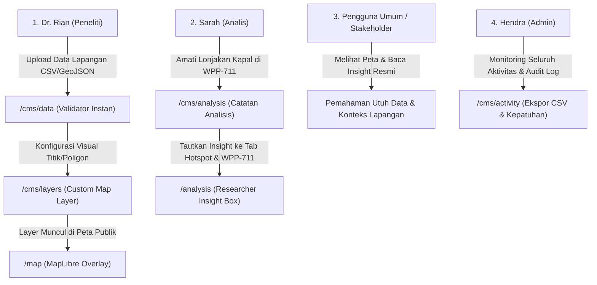

# Laporan Pengembangan Content Management System (CMS)
**Proyek:** Indonesia Fishing Watch (Platform Pemantauan Maritim & Perikanan Tangkap)  
**Dokumen:** Laporan Implementasi & Panduan CMS Peneliti  
**Tanggal:** 24 Oktober 2026  
**Status:** Selesai (100% Implemented & Tested)

---

## 1. Ringkasan Eksekutif (Executive Summary)

Sistem Informasi *Indonesia Fishing Watch* sebelumnya dirancang sebagai antarmuka pemantauan satu arah bagi pengguna akhir (*end-user*). Namun, seiring dengan kebutuhan operasional di lapangan, tim peneliti kelautan (*marine researchers*) non-IT membutuhkan fleksibilitas untuk:
1. Memperbarui dan memasukkan dataset spasial terbaru secara mandiri (*self-service data ingestion*).
2. Menambahkan fitur layer peta tematik baru tanpa bergantung pada tim pengembang/programmer (*custom map layers builder*).
3. Menerbitkan laporan temuan lapangan, buletin analisis berkala, dan panduan metodologi secara langsung melalui antarmuka visual yang mudah digunakan (*WYSIWYG article editor*).

Untuk menjaga kebersihan antarmuka publik, seluruh modul manajemen ini dipisahkan ke dalam ruang kerja khusus di **`/cms`**, sementara pengunjung umum tetap menikmati pengalaman navigasi pemantauan yang terfokus di **`/map`**, **`/analytics`**, dan **`/dokumentasi`**.

---

## 2. Persona Pengguna & User Story (User Personas & User Stories)

Untuk memastikan Content Management System (CMS) benar-benar menjawab kebutuhan operasional nyata di lapangan—terutama bagi tim non-IT—perancangan modul CMS didasarkan pada persona pengguna spesifik dan serangkaian *user story*.

### 2.1 Persona Pengguna

#### Persona 1: Dr. Rian Pratama (Senior Marine Researcher / Ahli Biologi Laut)
- **Peran Sistem:** `analyst` (Peneliti)
- **Latar Belakang:** Peneliti oseanografi dan konservasi laut di instansi kelautan. Terbiasa mengolah data sebaran keanekaragaman hayati laut, kawasan konservasi (KKP), dan jalur ruaya ikan, namun **tidak memiliki latar belakang pemrograman/koding (non-IT)**.
- **Tujuan Utama (*Goals*):**
  - Mengunggah data survei spasial lapangan (berkas CSV/GeoJSON) secara mandiri tanpa harus meminta bantuan programmer untuk mengubah source code atau database.
  - Memvisualisasikan batas kawasan konservasi baru atau rute ruaya ikan di atas peta pemantauan kapal (MapLibre) untuk mengamati potensi tumpang tindih dengan kapal penangkap ikan.
  - Menyisipkan catatan interpretasi ilmiah pada grafik analitik agar publik memahami korelasi musim angin muson terhadap penurunan aktivitas penangkapan.
- **Titik Frustrasi (*Pain Points*):**
  - Ketergantungan penuh pada tim pengembang untuk memperbarui data spasial statis.
  - Kekhawatiran salah format kolom atau format koordinat (Lintang/Bujur) yang dapat merusak aplikasi.
  - Kesulitan menulis tag HTML atau sintaks rumit saat ingin menyusun artikel atau laporan berkala.

#### Persona 2: Sarah Nabila, S.Kel (Analis Pengawasan Perikanan & IUU Fishing)
- **Peran Sistem:** `analyst` (Analis)
- **Latar Belakang:** Analis kepatuhan armada kapal perikanan dan pemantauan laut terpadu. Berfokus pada deteksi pola anomali pergerakan kapal (AIS gap, pertemuan di tengah laut/transshipment, dan pelanggaran batas ZEE).
- **Tujuan Utama (*Goals*):**
  - Menambahkan catatan peringatan (*warning callout*) pada tab "Kejadian di Laut" atau "Armada Kapal" di halaman `/analysis` saat ditemukan indikasi pelanggaran transshipment.
  - Memasukkan data koordinat titik pendaratan ikan ilegal atau rute patroli kapal pengawas terbaru.
  - Memeriksa log audit aktivitas untuk mengetahui kronologi siapa rekan tim yang baru saja memperbarui layer atau dataset pengawasan.
- **Titik Frustrasi (*Pain Points*):**
  - Tidak ada media resmi untuk menyematkan narasi kontekstual langsung di samping grafik data interaktif.
  - Kurangnya transparansi riwayat perubahan data jika terjadi ketidaksesuaian laporan lapangan.

#### Persona 3: Hendra Gunawan (Administrator Sistem & Manajer Data)
- **Peran Sistem:** `admin` (Administrator)
- **Latar Belakang:** Pengelola infrastruktur platform pemantauan maritim dan penanggung jawab operasional akun serta kuota API Global Fishing Watch (GFW).
- **Tujuan Utama (*Goals*):**
  - Memastikan tim peneliti non-IT memiliki lingkungan kerja mandiri yang aman (*sandboxed*) tanpa risiko merusak konfigurasi sistem inti atau tampilan publik.
  - Mengelola wewenang akun tim (memberikan peran `analyst`, mengundang anggota baru, atau menonaktifkan akun yang sudah tidak aktif).
  - Mengawasi penggunaan kuota API harian dan mengekspor seluruh log audit aktivitas untuk kebutuhan kepatuhan (*compliance*) instansi.
- **Titik Frustrasi (*Pain Points*):**
  - Beban kerja berulang melayani permintaan rutin tim peneliti hanya untuk mengunggah file data atau mengubah label peta.
  - Risiko keamanan jika akses pengelolaan data tidak terisolasi dari antarmuka publik.

---

### 2.2 User Stories & Kriteria Penerimaan (Acceptance Criteria)

Tabel berikut merangkum kebutuhan fungsional dalam format standar industri (*As a [role], I want to [feature], so that [benefit]*):

| ID | Persona | As a (Peran) | I want to (Kebutuhan / Fitur) | So that (Manfaat / Nilai Tambah) | Kriteria Penerimaan (Acceptance Criteria) |
|---|---|---|---|---|---|
| **US-01** | Dr. Rian | Peneliti Kelautan Non-IT | Mengunggah file CSV atau GeoJSON dengan validasi instan di layar browser | Saya dapat memastikan koordinat spasial dan kolom terdeteksi sebelum disimpan tanpa takut merusak sistem | Validasi mendeteksi latitude/longitude, tipe geometri GeoJSON, menyajikan 5 baris pratinjau data dan pesan peringatan jika kolom koordinat tidak lengkap. |
| **US-02** | Dr. Rian | Peneliti Kelautan | Mengonfigurasi layer peta tematik baru (warna, ukuran titik, transparansi poligon) secara visual | Lapisan konservasi perairan saya langsung aktif di peta MapLibre (`/map`) tanpa perlu koding | Layer baru otomatis muncul di panel samping peta publik pada bagian *Layer Riset Tambahan (CMS)* lengkap dengan kontrol aktif/mati. |
| **US-03** | Dr. Rian | Peneliti Kelautan | Menyusun artikel dan panduan metodologi dengan editor visual WYSIWYG serta kotak sorotan (*callout*) | Saya dapat menerbitkan panduan dan laporan riset yang rapi dan nyaman dibaca publik di menu `/dokumentasi` | Editor menyediakan tombol Heading, List, Gambar URL, dan kotak sorotan khusus (💡 Info, 🔍 Temuan, ⚠️ Perhatian) dengan pratinjau langsung. |
| **US-04** | Sarah | Analis Pengawasan | Menambahkan catatan interpretasi dan temuan lapangan pada tab tertentu di halaman `/analysis` | Pengunjung dan stakeholder memahami penyebab anomali data di wilayah (WPP) yang bersangkutan | Catatan dapat ditautkan ke tab tertentu (*Tren, Kapal, Hotspot, WPP, Kejadian*) dan wilayah tertentu (*misal WPP 711*), lalu tampil otomatis di atas grafik. |
| **US-05** | Sarah | Analis Pengawasan | Mengatur status catatan menjadi *Draft* atau *Published* serta mengaktifkan/menonaktifkan kapan saja | Catatan yang masih dalam penelaahan internal tidak langsung bocor ke publik sebelum terverifikasi | Status Draft menyembunyikan catatan dari halaman publik `/analysis`, sementara status Published merendernya seketika. |
| **US-06** | Hendra | Administrator | Memisahkan seluruh fungsi manajemen ke ruang kerja terlindungi di `/cms` | Tampilan publik tetap bersih dan antarmuka manajemen hanya dapat diakses akun berwenang | Pengguna publik (role `viewer` atau tanpa login) dialihkan secara otomatis jika mencoba membuka `/cms/*`. |
| **US-07** | Hendra | Administrator | Memantau grafik tren frekuensi tindakan 14 hari dan mengekspor seluruh log audit ke berkas CSV | Saya memiliki rekam jejak kepatuhan (*audit trail*) transparan untuk laporan ke pimpinan instansi | Tersedia grafik batang tren harian, filter kategori modul, tombol ekspor CSV dengan encoding UTF-8, serta modal rincian perubahan payload. |

---

### 2.3 Skenario Perjalanan Pengguna (End-to-End User Journey)

Berikut adalah contoh skenario siklus kerja terpadu antara tim peneliti, analis, dan administrator:



---

## 3. Arsitektur & Keamanan (Architecture & Access Control)

### 3.1 Role-Based Access Control (RBAC)
Sistem hak akses diperbarui untuk memberikan wewenang terukur kepada tim peneliti tanpa mengorbankan keamanan sistem inti:

| Role | Level | Hak Akses Utama |
|---|:---:|---|
| **Viewer** | 0 | Akses peta pemantauan publik, data agregat, pembaca artikel dokumentasi. Tidak dapat mengakses area CMS. |
| **Analyst (Peneliti)** | 1 | Akses penuh ke CMS Data Ingestion, Custom Map Layers Builder, dan Publikasi Artikel/Buletin. |
| **Admin** | 2 | Seluruh hak akses Analyst + Manajemen Akun Pengguna (`/cms/users`) & Konfigurasi Kuota API GFW (`/cms/settings`). |

### 3.2 Dedicated Back-Office Shell (`/cms`)
- Terisolasi di rute `/cms/*` dengan proteksi middleware/layout server-side: hanya akun berstatus `analyst` atau `admin` yang dapat mengakses.
- Pengguna yang tidak memiliki hak akses dialihkan secara otomatis ke halaman login atau beranda.
- Desain antarmuka back-office seragam (*clean dark maritime theme*), dilengkapi bilah navigasi samping, rekap statistik instan, serta tombol pintas kembali ke aplikasi pemantauan publik.
- **Konfigurasi Visibilitas Sidebar (Sesuai Permintaan):**
  - Menu aktif yang ditampilkan di bilah samping: **Ikhtisar CMS** (`/cms`), **Data & Dataset Riset** (`/cms/data`), dan **Pengaturan Sistem** (`/cms/settings`).
  - Menu yang disembunyikan sementara (*hidden*): *Lapisan Peta Kustom*, *Catatan Analisis (/analysis)*, *Konten & Panduan*, *Log Audit Aktivitas*, dan *Pengguna & Akses* (kode backend & modul tetap utuh dan siap diaktifkan kembali sewaktu-waktu).

### 3.3 Penyimpanan Data & Mesin Database
- **SQLite Engine (`node:sqlite`)**: Menggunakan built-in zero-dependency `DatabaseSync` bawaan Node.js, menjaga performa tetap ringan dan portabel tanpa dependensi native eksternal.
- **Skema Database Baru**:
  - `research_datasets`: Menyimpan metadata berkas CSV/GeoJSON, jumlah baris/fitur, bounding box spasial, dan informasi pengunggah.
  - `custom_map_layers`: Menyimpan konfigurasi visual layer peta (tipe geometri, palet warna, stroke, opacity, dan visibilitas default).
  - `cms_articles`: Menyimpan konten artikel riset (judul, ringkasan, body, slug URL unik, kategori, status terbit, estimasi waktu baca).
- **Penyimpanan Berkas Fisik**: Berkas unggahan mentah dan hasil konversi spasial disimpan rapi di direktori terlindungi `data/research-uploads/`.

---

## 4. Rincian Milestone yang Diselesaikan

### Milestone 1: Self-Service Research Data Ingestion & Validator (`/cms/data`)
*Tujuan: Memfasilitasi peneliti memasukkan data lapangan tanpa risiko format error.*

- **Fitur Utama:**
  - Area unggah berkas *drag-and-drop* mendukung format `.csv` dan `.geojson`.
  - **Pratinjau & Validasi Real-time:** Sistem otomatis membaca dan memverifikasi berkas sebelum disimpan:
    - Memeriksa kelengkapan koordinat spasial (deteksi otomatis kolom `latitude`, `longitude`, `lat`, `lon`, `lng`, dsb.).
    - Memverifikasi struktur standar GeoJSON (`FeatureCollection`, `Feature`, geometri valid).
    - Menghitung jumlah record, perkiraan ukuran berkas, dan menyajikan 5 baris data teratas sebagai pratinjau instan.
  - **Kategorisasi Riset:** Pengelompokan data berbasis domain maritim Indonesia (Kawasan Konservasi Perairan/KKP, Pelabuhan & Pendaratan Ikan, Rute Patroli, Habitat Penting/Mangrove/Terumbu Karang, Zona Tambang Laut, dan Batas Wilayah Adat).
  - **Katalog & Manajemen Dataset:** Peneliti dapat melihat daftar dataset terpasang, mengunduh salinan berkas mentah, atau menghapus dataset yang usang.

### Milestone 2: Custom Map Layers Builder (`/cms/layers`)
*Tujuan: Memungkinkan peneliti menambahkan layer peta tematik baru secara visual tanpa perlu koding.*

- **Fitur Utama:**
  - Pembuat layer langsung dari dataset yang sudah diunggah pada Milestone 1.
  - **Dukungan Geometri Spasial:**
    - **Titik (Point):** Kustomisasi warna titik, radius lingkaran (2–20px), warna garis tepi (*stroke*), dan ketebalan garis.
    - **Garis (LineString):** Kustomisasi warna garis dan ketebalan garis rute/lintasan patroli.
    - **Poligon (Polygon / MultiPolygon):** Kustomisasi warna isian (*fill*), transparansi (*opacity 0.0 – 1.0*), dan warna batas luar (*outline*).
  - **Streaming API Spasial:** Endpoint dinamis `/api/cms/layers/[id]/geojson` yang secara otomatis mengonversi CSV bertitik koordinat menjadi GeoJSON standar dan menyajikannya secara efisien ke mesin peta.
  - **Integrasi Peta MapLibre (`/map`):**
    - Layer yang dibuat di CMS otomatis muncul di panel kontrol samping peta pada bagian *"Layer Riset Tambahan (CMS)"*.
    - Peneliti maupun pengguna publik dapat mengaktifkan/menonaktifkan layer secara interaktif, lengkap dengan legenda warna dan transparansi yang dapat diatur langsung.

### Milestone 3: Visual WYSIWYG Content Editor & Publikasi (`/cms/articles`)
*Tujuan: Menyediakan sarana publikasi temuan riset, panduan metodologi, dan buletin berkala secara terstruktur.*

- **Fitur Utama:**
  - **Visual Toolbar Editor:** Penulisan format rich text tanpa perlu memahami tag HTML/Markdown:
    - Heading (H2, H3), Bold, Italic, Bulleted List, Numbered List, dan Kutipan (*Blockquote*).
    - Penyisipan tautan web dan gambar via URL dengan pratinjau langsung.
    - **Kotak Sorotan Khusus (Maritime Callout Boxes):**
      - 💡 **Informasi Tambahan** (Highlight biru untuk konteks metodologi)
      - 🔍 **Temuan Lapangan / Insight** (Highlight hijau untuk data observasi)
      - ⚠️ **Perhatian Khusus / Warning** (Highlight kuning/oranye untuk peringatan IUU Fishing / anomali)
  - **Manajemen Publikasi:**
    - Dukungan status berkas: **Draft** (hanya terlihat di CMS) dan **Published** (terbit ke publik).
    - Pembuatan *Slug URL* otomatis yang ramah SEO dan anti-duplikasi (*collision-resistant*).
    - Estimasi waktu baca (*reading time*) otomatis dihitung berdasarkan panjang kata.
  - **Halaman Dokumentasi Publik (`/dokumentasi`):**
    - Indeks artikel publik menampilkan filter kategori, tanggal terbit, dan estimasi baca.
    - Halaman pembaca responsif di `/dokumentasi/artikel/[slug]` dengan format tipografi yang nyaman dibaca di desktop maupun perangkat mobile.

### Milestone 4: Statistik Aktivitas Tim & Audit Observabilitas (`/cms/activity`)
*Tujuan: Menyediakan transparansi dan monitoring komprehensif atas seluruh tindakan pengguna, peneliti, dan perubahan sistem di dalam CMS.*

- **Fitur Utama:**
  - **4 Indikator KPI Real-time:**
    - Total aktivitas operasional 30 hari terakhir.
    - Aktivitas harian hari ini (UTC).
    - Agregasi aksi riset & konten (dataset, custom layers, artikel).
    - Kontributor teraktif dalam 30 hari.
  - **Grafik Batang Tren 14 Hari (Interactive Bar Chart):**
    - Visualisasi distribusi tindakan tim per hari (UTC) tanpa library berat pihak ketiga.
    - Tooltip interaktif yang menampilkan tanggal dan rincian jumlah aksi saat diarahkan kursor.
  - **Distribusi Kategori Modul:**
    - Visual progress bar memetakan porsi aktivitas: Data Riset, Lapisan Peta, Konten/Artikel, Temuan Riset, dan Sesi Pengguna.
  - **Daftar Log Interaktif & Pencarian:**
    - Filter kategori aksi (Semua, Data Riset, Lapisan Peta, Konten, Temuan, Autentikasi, Sistem).
    - Filter rentang waktu (24 Jam Terakhir, 7 Hari, 30 Hari, Semua).
    - Kotak pencarian menyeluruh (mencari nama aktor, email, aksi, atau isi payload).
    - Modal inspeksi detail perubahan (*change payload inspector*) yang memformat JSON mentah menjadi tabel yang mudah dipahami non-IT.
  - **Ekspor Log Aktivitas (CSV):**
    - Tombol sekali klik untuk mengunduh log audit terfilter ke dalam berkas `aktivitas-cms-YYYY-MM-DD.csv` ber-BOM UTF-8.

### Milestone 5: Manajemen Catatan & Insight Analis untuk Halaman Statistik Aktivitas (`/analysis`)
*Tujuan: Memfasilitasi peneliti kelautan untuk mengelola narasi interpretasi tren, observasi armada kapal lapangan, dan rekomendasi kebijakan yang tampil secara dinamis pada halaman publik Statistik Aktivitas (`/analysis`).*

- **Fitur Utama:**
  - **Penargetan Kontekstual Multi-Dimensi:**
    - Peneliti dapat menautkan catatan ke **Tab Analisis Tertentu** (*Naik-Turun / Tren, Kapal & Alat Tangkap, Hotspot / Lokasi Teramai, Peringkat WPP, Kejadian di Laut, Perbandingan, atau Semua Tab*).
    - Peneliti dapat menautkan catatan ke **Wilayah Tertentu** (*misal WPP-NRI 711 Natuna, WPP-NRI 718 Arafura, ZEE Indonesia, atau Catatan Umum Nasional*).
    - Peneliti dapat menautkan catatan ke **Metrik Tertentu** (*Jam Penangkapan, Jam Keberadaan, Deteksi VIIRS, atau Radar SAR*).
  - **Klasifikasi Insight:**
    - 💡 **Interpretasi Tren:** Penjelasan faktor musiman (angin barat/timur), fluktuasi oseanografi, atau cuaca ekstrem.
    - 🔍 **Temuan Lapangan:** Observasi kapal berbendera asing, anomali transshipment, atau pola alat tangkap baru.
    - ⚠️ **Peringatan Khusus:** Area rawan IUU fishing atau keterbatasan sensor radar satelit.
    - 📋 **Rekomendasi Kebijakan:** Saran fokus patroli terarah atau pengawasan lintas instansi.
  - **Rendering Dinamis di Halaman Publik (`/analysis`):**
    - Komponen `<ResearcherInsightBox />` otomatis memuat dan merender catatan yang relevan saat pengguna memilih tab dan wilayah tertentu.
    - Dilengkapi kartu beraksen warna (*blue, green, amber*) sesuai jenis catatan, nama analis penulis, dan stempel waktu UTC terkini.
  - **Manajemen Mandiri di CMS (`/cms/analysis`):**
    - Dialog penulisan dan pengeditan dengan pratinjau langsung (*live preview*).
    - Switch aktivasi/deaktivasi instan (Aktif vs Draft).

---

## 5. Struktur Berkas yang Dibuat & Dimodifikasi

```
indonesia-fishing-watch/
├── src/
│   ├── app/
│   │   ├── (app)/
│   │   │   ├── analysis/page.tsx                [Modified: Integrasi ResearcherInsightBox]
│   │   │   └── dokumentasi/
│   │   │       ├── page.tsx                     [Modified: Integrasi artikel CMS]
│   │   │       └── artikel/[slug]/page.tsx      [New: Halaman pembaca artikel publik]
│   │   ├── api/cms/
│   │   │   ├── datasets/route.ts & [id]/route.ts [New: API upload, list, download, delete data]
│   │   │   ├── validate/route.ts                 [New: API validasi data instan]
│   │   │   ├── layers/route.ts & [id]/route.ts   [New: API CRUD custom map layers]
│   │   │   ├── layers/[id]/geojson/route.ts      [New: API streaming GeoJSON untuk MapLibre]
│   │   │   ├── articles/route.ts & [id]/route.ts [New: API CRUD artikel riset]
│   │   │   ├── activity/route.ts                 [New: API audit log & statistik aktivitas]
│   │   │   ├── activity/export/route.ts          [New: API ekspor CSV log aktivitas]
│   │   │   └── analysis-insights/route.ts & [id] [New: API CRUD catatan insight analisis]
│   │   └── cms/
│   │       ├── layout.tsx                       [New: Role guard analyst/admin]
│   │       ├── page.tsx                         [Modified: CMS Dashboard, 4-card grid & mini audit]
│   │       ├── data/page.tsx                    [New: Halaman manajemen dataset]
│   │       ├── layers/page.tsx                  [New: Halaman konfigurasi layer peta]
│   │       ├── analysis/page.tsx                [New: Halaman manajemen insight /analysis]
│   │       ├── articles/page.tsx                [New: Halaman manajemen & penulisan artikel]
│   │       ├── activity/page.tsx                [New: Halaman statistik & log aktivitas tim]
│   │       ├── users/page.tsx                   [New: Manajemen pengguna & role (admin)]
│   │       └── settings/page.tsx                [New: Konfigurasi kuota GFW (admin)]
│   ├── components/
│   │   ├── analysis/
│   │   │   └── ResearcherInsightBox.tsx         [New: Komponen rendering kotak insight di /analysis]
│   │   ├── cms/
│   │   │   ├── CmsShell.tsx                     [Modified: Navigasi CMS + Catatan Analisis]
│   │   │   ├── DataManagementClient.tsx         [New: Komponen drag-drop & validator data]
│   │   │   ├── LayersManagementClient.tsx       [New: Komponen konfigurasi visual layer peta]
│   │   │   ├── ArticlesManagementClient.tsx     [New: Komponen daftar artikel CMS]
│   │   │   ├── VisualArticleEditor.tsx          [New: Editor WYSIWYG & kotak sorotan]
│   │   │   ├── ActivityManagementClient.tsx     [New: Dashboard analitik audit log & bar chart]
│   │   │   └── AnalysisInsightsManagementClient [New: Manajemen insight & narasi /analysis]
│   │   ├── layout/
│   │   │   ├── AccountMenu.tsx                  [Modified: Tombol pintas Panel CMS]
│   │   │   └── nav-items.ts                     [Modified: Pembersihan navigasi publik]
│   │   └── map/
│   │       ├── MapExplorer.tsx                  [Modified: Integrasi custom layers overlay]
│   │       └── CustomLayersOverlay.tsx          [New: Komponen MapLibre source & layer renderer]
│   └── lib/
│       ├── auth/roles.ts                        [Modified: Penambahan permission CMS]
│       ├── db/
│       │   ├── index.ts                         [Modified: Fix polyfill isTransaction node:sqlite]
│       │   └── migrations.ts                    [Modified: Migrasi 9 (data/layers), 10 (articles), 11 (insights)]
│       └── cms/
│           ├── types.ts                         [Modified: Tipe dataset, layer, artikel, aktivitas & insight]
│           ├── validator.ts & .test.ts          [New: Engine parser & validator berkas]
│           ├── datasets.ts                      [New: Service data & storage controller]
│           ├── layers.ts & .test.ts             [New: Service custom map layers]
│           ├── articles.ts & .test.ts           [New: Service artikel & slug generator]
│           ├── activity.ts & .test.ts           [New: Service analitik audit log & ekspor CSV]
│           └── analysis-insights.ts & .test.ts  [New: Service catatan & insight analisis /analysis]
```

---

## 6. Hasil Pengujian & Jaminan Mutu (QA)

| Kategori Pengujian | Perintah | Hasil | Catatan |
|---|---|:---:|---|
| **Type Check** | `npx tsc --noEmit` | **Lolos (0 error)** | Seluruh tipe TypeScript tersinkronisasi antara Client dan Server. |
| **Unit Testing** | `npm test` | **100% Lolos** | **26 test file**, **151 skenario unit test** berjalan sukses. |
| **Validator Test** | `validator.test.ts` | **4/4 Lolos** | Pengujian parsing CSV berkoordinat, deteksi anomali kolom, dan validasi geometri GeoJSON. |
| **Layers Test** | `layers.test.ts` | **3/3 Lolos** | Pengujian pembuatan layer Point/Polygon serta konversi CSV-ke-GeoJSON otomatis. |
| **Articles Test** | `articles.test.ts` | **4/4 Lolos** | Pengujian siklus hidup artikel, slugification, pencegahan duplikasi slug, dan status filter. |
| **Activity Test** | `activity.test.ts` | **4/4 Lolos** | Pengujian agregasi tren 14 hari, breakdown kategori, filter pencarian, dan pembuatan CSV. |
| **Insights Test** | `analysis-insights.test.ts` | **4/4 Lolos** | Pengujian pencocokan kontekstual tab/wilayah, filter aktif, update, dan audit log. |

---

## 7. Panduan Penggunaan Cepat untuk Tim Peneliti

### A. Cara Menambahkan Dataset Baru
1. Masuk ke aplikasi menggunakan akun peneliti, klik nama/foto profil di pojok kanan atas, lalu klik **"Panel CMS"**.
2. Masuk ke tab **"Data Riset"** (`/cms/data`).
3. Tarik berkas `.csv` atau `.geojson` Anda ke dalam kotak unggah.
4. Periksa hasil validasi otomatis di layar (pastikan kolom koordinat atau geometri terdeteksi hijau).
5. Pilih **Kategori Data** yang sesuai, beri judul dan deskripsi singkat, lalu klik **"Simpan Dataset"**.

### B. Cara Menampilkan Dataset Menjadi Layer Baru di Peta
1. Di Panel CMS, masuk ke tab **"Layer Peta"** (`/cms/layers`).
2. Klik tombol **"+ Tambah Layer Baru"**.
3. Pilih salah satu dataset yang telah Anda unggah sebelumnya.
4. Tentukan warna layer menggunakan palet visual (misal: Oranye Cerah, Biru Laut, atau Merah).
5. Tentukan ukuran titik atau transparansi area poligon.
6. Centang opsi **"Aktifkan di Peta"**, lalu klik **"Simpan Layer"**.
7. Buka halaman peta utama (`/map`). Layer baru Anda kini langsung muncul dan dapat diaktifkan pada panel *"Layer Riset Tambahan (CMS)"*.

### C. Cara Menulis & Menerbitkan Buletin/Artikel Riset
1. Di Panel CMS, masuk ke tab **"Artikel & Buletin"** (`/cms/articles`).
2. Klik tombol **"Tulis Artikel Baru"**.
3. Masukkan judul artikel, pilih kategori (misal: *Temuan Lapangan* atau *Buletin Bulanan*).
4. Gunakan editor visual untuk mengetik naskah, menambahkan gambar, atau menyisipkan **Kotak Temuan Lapangan**.
5. Ubah status menjadi **"Published"** dan klik **"Simpan Artikel"**.
6. Artikel Anda langsung terbit dan dapat diakses publik di menu **"Dokumentasi"** (`/dokumentasi`).

### D. Cara Memantau & Mengekspor Log Aktivitas Tim
1. Di Panel CMS, pilih menu **"Log Audit Aktivitas"** (`/cms/activity`).
2. Pantau grafik batang tren tindakan harian 14 hari terakhir dan metrik aktivitas 30 hari.
3. Gunakan filter dropdown untuk menyaring jenis tindakan (misal: hanya melihat riwayat *Data Riset* atau *Lapisan Peta*).
4. Klik tombol **"Perubahan"** pada baris data untuk melihat rincian isi payload properti yang diubah.
5. Klik tombol **"Ekspor Log (CSV)"** di pojok kanan atas untuk mengunduh seluruh berkas audit terfilter untuk keperluan pelaporan instansi atau backup.

### E. Cara Mengelola Catatan & Insight Analis untuk Halaman Statistik Aktivitas (`/analysis`)
1. Di Panel CMS, pilih menu **"Catatan Analisis (/analysis)"** (`/cms/analysis`).
2. Klik tombol **"+ Tambah Catatan Baru"**.
3. Masukkan judul catatan (misal: *Konteks Musim Angin Barat Natuna Utara*).
4. Pilih **Jenis Catatan**:
   - 💡 *Interpretasi Tren* (konteks musiman/oseanografi)
   - 🔍 *Temuan Lapangan* (kapal asing, transshipment)
   - ⚠️ *Peringatan Khusus* (keterbatasan radar atau kerawanan IUU)
   - 📋 *Rekomendasi Kebijakan* (fokus patroli)
5. Pilih **Target Tab Analisis** (misal: *Naik-Turun (Tren)* atau *Kapal & Alat Tangkap*) dan **Target Wilayah** (misal: *WPP-NRI 711* atau *Semua Wilayah*).
6. Tuliskan narasi penjelasan ilmiah, lalu pastikan centang opsi **"Aktifkan langsung di halaman /analysis"**.
7. Klik **"Simpan & Publikasikan"**.
8. Buka halaman publik [`/analysis`](http://localhost:3000/analysis) dan pilih tab/wilayah yang sesuai. Kotak catatan peneliti berlabel resmi akan langsung muncul tepat di atas grafik/data untuk memandu pengguna!

---

## 8. Saran Rekomendasi Pengembangan Lanjutan (Roadmap)
1. **Analisis Spasial Tumpangsusun (*Spatial Intersection*):**
   - Menghubungkan layer titik/poligon custom dari CMS dengan koordinat kapal AIS GFW untuk menghitung otomatis jumlah insiden kapal yang melintas di dalam area konservasi yang diunggah peneliti.
2. **Penyimpanan Berkas Gambar Lokal (*Direct Media Upload*):**
   - Menambahkan endpoint upload langsung untuk gambar artikel ke folder lokal `data/article-images/` sehingga peneliti tidak perlu menyematkan URL gambar eksternal.
3. **Ekspor & Impor Cadangan (*Backup/Restore Archive*):**
   - Fitur sekali klik untuk mengunduh seluruh dataset riset dan artikel dalam satu berkas `.zip`.
