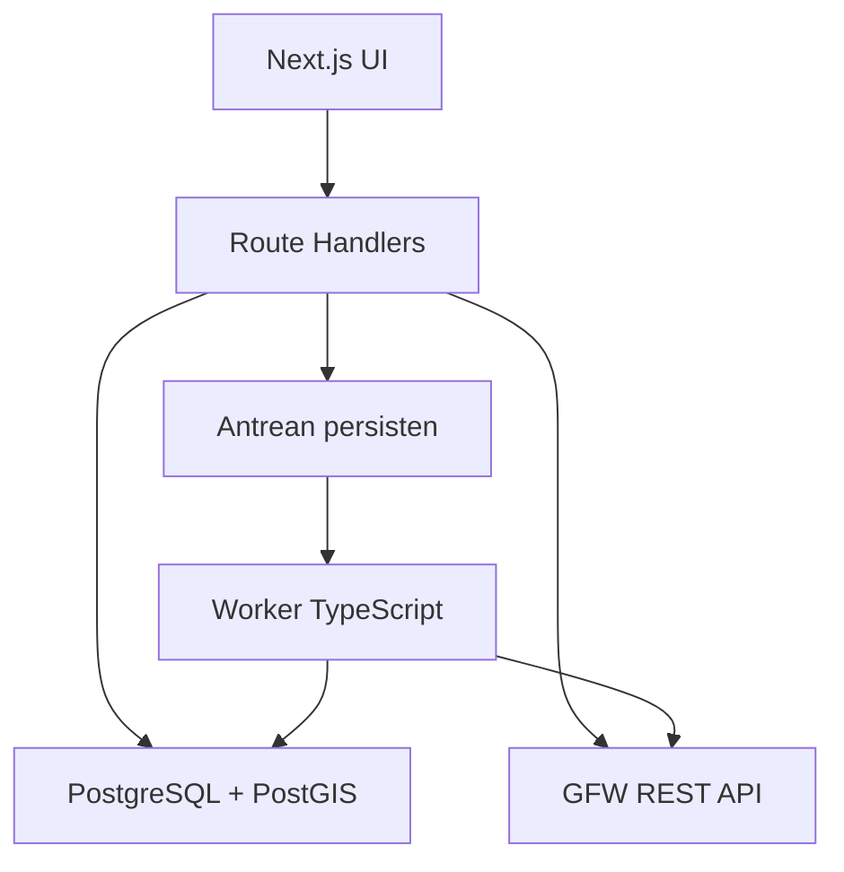

# PRD — Platform Pemantauan Maritim Indonesia

Versi: 1.0 · Tanggal: 13 Oktober 2026 · Bahasa produk: Indonesia.

Nama: **Indonesia Fishing Watch** (sebelumnya nama kerja “Pantau Laut”; diganti 14 Okt 2026).

Status: spesifikasi untuk implementasi berikutnya; belum merupakan aplikasi yang telah dibangun atau integrasi API yang telah diuji dengan token pengguna.

Dokumen pasangan: [Design system](Design_System_Pemantauan_Maritim_Indonesia.md).

## 1. Ringkasan keputusan

| Aspek | Keputusan versi awal |
| --- | --- |
| Tujuan | Membantu pengguna memantau aktivitas maritim yang teramati, membandingkan WPP, menelusuri kapal, dan mencatat temuan |
| Cakupan | Aktivitas dalam wilayah Indonesia yang poligonnya telah divalidasi; pilihan analisis per WPPNRI |
| Sumber aktivitas utama | API publik Global Fishing Watch (GFW) |
| Frontend | Next.js App Router dan TypeScript |
| Backend web | Next.js Route Handlers, runtime Node.js, sebagai Backend for Frontend (BFF) |
| Pemrosesan lama | Worker TypeScript terpisah dengan antrean persisten; bukan promise yang ditinggalkan setelah respons HTTP |
| Penyimpanan | PostgreSQL + PostGIS untuk metadata wilayah, hasil olahan, antrean, dan temuan |
| Peta | MapLibre GL JS; penyedia basemap dipilih setelah lisensi dan aksesnya diperiksa |
| Desain | Putih, hijau tua sebagai aksi utama, lime sebagai aksen grafik; layout lapang dan peta mudah dibaca |
| Python | Tidak wajib pada MVP. Opsi worker analisis/ML di fase berikutnya |
| Tracking | Profil dan riwayat kejadian tersedia; lintasan lengkap dan posisi langsung tidak dijanjikan |
| Machine learning | Tidak menjadi syarat MVP; analisis deskriptif dan aturan transparan lebih dahulu |

API GFW adalah layanan HTTP REST. Contoh Python merupakan salah satu cara mengaksesnya, bukan persyaratan bahasa backend. Next.js dapat mengirim permintaan dari server, menyembunyikan token, dan menormalisasi respons. Pekerjaan lama tetap memerlukan worker yang hidup terpisah dari siklus request. Dasar: [S01], [S11].

## 2. Aturan membaca dokumen

- **FAKTA-DOK**: didukung dokumentasi resmi yang dibaca pada 13 Oktober 2026.
- **KEPUTUSAN**: pilihan produk/teknis dalam PRD ini; bukan klaim kemampuan bawaan GFW.
- **GATE**: harus diperiksa dengan data atau akses nyata sebelum fitur dapat dinyatakan siap.
- **LANJUTAN**: bukan bagian release MVP.

Tidak ada angka kapal, hasil analisis, nama pelabuhan lokal, koordinat kapal, skor risiko, atau keberhasilan koneksi yang diklaim nyata dalam dokumen ini. Contoh objek kontrak internal merupakan bentuk yang dirancang, bukan contoh hasil pengambilan data.

## 3. Masalah yang diselesaikan

Data aktivitas kapal tersedia dalam beberapa bentuk, tetapi pengguna perlu melihatnya dalam konteks Indonesia: wilayah mana yang padat, bagaimana polanya berubah, kapal apa yang berkontribusi, dan temuan apa yang perlu ditinjau.

Produk mengurangi pekerjaan berpindah antara peta, tabel identitas, grafik, dan catatan pemeriksaan. Produk tidak menggantikan sistem pengawasan resmi, pemeriksaan lapangan, atau penetapan pelanggaran.

Pertanyaan utama yang harus dapat dijawab:

1. Di wilayah yang dipilih, bagaimana sebaran jam apparent fishing dan keberadaan kapal berbasis AIS?
2. Bagaimana perubahan aktivitas teramati antara dua periode dengan definisi yang sama?
3. Identitas dan riwayat kejadian apa yang tersedia untuk suatu kapal?
4. Di mana deteksi radar memiliki atau belum memiliki pasangan AIS menurut GFW?
5. Temuan mana yang disimpan pengguna dan bagaimana status peninjauannya?

## 4. Pengguna dan akses

MVP merupakan pilot internal satu workspace, bukan layanan multi-instansi yang sudah terintegrasi dengan pemerintah.

| Peran | Kebutuhan | Hak MVP |
| --- | --- | --- |
| Viewer | Melihat peta, ringkasan, profil, laporan yang dibagikan dalam workspace | Baca data dan unduh laporan yang diizinkan |
| Analyst | Menelusuri aktivitas dan mendokumentasikan temuan | Hak Viewer + membuat temuan dan menambahkan catatan |
| Admin | Mengelola akses dan sumber data | Hak Analyst + kelola pengguna, status sinkronisasi, dataset dan wilayah |

Login berbasis undangan diperlukan untuk pilot. Provider autentikasi belum dipilih; sesi harus diverifikasi di server pada setiap rute terlindungi. Tidak ada signup publik pada MVP. Data GFW bukan data rahasia milik aplikasi; catatan internal pengguna dipisahkan dari data publik sumber.

## 5. Tujuan dan ukuran keberhasilan

### 5.1 Tujuan produk

- Menyediakan peta dan analisis Indonesia dengan konteks wilayah yang konsisten.
- Menampilkan satuan, periode, sumber, dan kelengkapan pada setiap hasil.
- Mendukung penelusuran dari ringkasan menuju lokasi, kapal, atau kejadian.
- Menghasilkan temuan dan laporan yang dapat ditinjau kembali.

### 5.2 Sasaran validasi pilot

Sasaran berikut adalah target penerimaan, belum merupakan capaian:

| Ukuran | Target pilot | Cara mengukur |
| --- | --- | --- |
| Tugas inti | Pengguna dapat memilih WPP, melihat tren, membuka profil, dan menyimpan temuan | Sesi tugas dengan minimal 3 calon pengguna; catat hambatan |
| Konsistensi data | Total pada UI dan CSV konsisten untuk snapshot dan filter identik | Rekonsiliasi fixture serta satu sampel sumber nyata |
| Kejujuran status | Semua hasil memiliki sumber, periode, dan status kelengkapan | Audit semua komponen data |
| Keamanan token | Token tidak muncul di bundle browser, URL, log publik, atau ekspor | Pemeriksaan build dan request browser |
| Waktu respons cache | p95 API internal sederhana di bawah 2 detik pada lingkungan pilot | Minimal 30 request cache hit dengan beban pilot yang dicatat |
| Pengalaman awal | Shell dan status loading tampil di bawah 3 detik pada perangkat/jaringan uji yang dicatat | Uji browser; tidak mengukur waktu report GFW sebagai waktu shell |

Tidak menjanjikan SLA upstream atau waktu selesai ekspor sebelum integrasi nyata diukur.

## 6. Ketersediaan data dan batas cakupan

### 6.1 Matriks sumber

| Produk data | Kondisi berdasarkan dokumentasi | Keputusan |
| --- | --- | --- |
| AIS apparent fishing effort | API 4Wings; besaran jam aktivitas perkiraan | P0: peta, ringkasan, tren |
| AIS vessel presence | API 4Wings; keberadaan berbasis grid, bukan trajectory lengkap | P0: layer dan statistik keberadaan |
| Vessel identity | Vessel API; AIS dan registry | P0: pencarian dan profil |
| Fishing, encounters, loitering, port visits | Events API | P0: riwayat kejadian sesuai data tersedia |
| Sentinel-1 SAR vessel detections | API 4Wings | P0: layer dan agregasi radar setelah akses divalidasi |
| AIS gap | Produk API dengan caveat/prototype yang perlu dibaca | P1: riwayat berlabel perkiraan; nonaktif pada MVP pertama |
| VIIRS night-light detections | Belum tersedia pada API publik menurut tabel GFW | P2: data VBD pengguna atau jalur resmi lain; tidak tampil sebagai layer aktif MVP |
| Sentinel-2 vessel detections | Belum API publik; tersedia melalui portal unduhan | P2: impor resmi terpisah jika dipilih |
| Pelabuhan/anchorages sebagai katalog | Belum API publik; tersedia melalui unduhan GFW | P1: impor satu kali; MVP memakai referensi pelabuhan dari port-visit events |
| Infrastruktur lepas pantai Sentinel-1/2 | Produk API berbeda dari deteksi kapal Sentinel-2 | P2: tidak dibutuhkan MVP |
| Full AIS tracks / AIS langsung | Tidak ada kontrak publik terverifikasi dalam rancangan ini | Di luar scope; perlu akses tambahan yang sah |

FAKTA-DOK bersumber dari [S02]–[S06], [S10]. Sumber aktivitas MVP tetap API GFW; batas wilayah dan basemap adalah dependensi pendukung yang harus memiliki asal dan lisensi sendiri.

### 6.2 Waktu dan pembaruan

Dokumen 4Wings/key concepts menyebut AIS sampai sekitar 96 jam sebelumnya dan SAR sekitar lima hari sebelumnya. Halaman availability menggunakan angka 72 jam pada beberapa produk. Perbedaan dokumentasi ini tidak diselesaikan dengan mengarang satu SLA. [S02], [S03], [S06].

Simpan dan bedakan:

- `fetchedAt`: kapan aplikasi memperoleh hasil.
- `requestedStart` / `requestedEnd`: periode yang diminta.
- `latestObservationAt`: waktu observasi maksimum yang benar-benar terdapat dalam hasil, jika tersedia.
- `providerAvailableThrough`: akhir ketersediaan yang dinyatakan provider, hanya jika ada metadata sah.
- `completeness`: `complete`, `partial`, atau `unknown`.

Observasi paling akhir di suatu wilayah tidak membuktikan semua tanggal sebelumnya lengkap. Jika provider tidak menyatakan ketersediaan, UI menggunakan “Observasi terakhir dalam hasil” dan “Kelengkapan belum diketahui”, bukan “Data lengkap sampai”.

Default pilot: 30 hari UTC penuh, berakhir lima hari sebelum hari ini, sebagai buffer desain awal; bukan jaminan lengkap. Provider masih harus diperiksa. Rentang interaktif awal maksimum 90 hari; permintaan lebih panjang dibagi worker dan tidak membuka query nasional bertahun-tahun tanpa batas.

### 6.3 Definisi geografis

- **Indonesia** berarti aktivitas yang berada dalam poligon cakupan pilihan, bukan kapal berbendera `IDN` di seluruh dunia.
- Kapal berbendera asing tetap masuk hasil jika aktivitasnya berada dalam wilayah pilihan.
- WPPNRI dan EEZ tidak diperlakukan sebagai geometri yang identik.
- Ocean/national scope tidak dibuat dari kotak longitude/latitude sebagai batas resmi.
- Simpan versi, penerbit, tanggal, CRS, dan hash setiap geometri.
- EPSG:4326 menjadi format pertukaran; koordinat GeoJSON berurutan longitude, latitude.
- WPP dikenal sebagai kode `571`, `572`, `573`, `711`, `712`, `713`, `714`, `715`, `716`, `717`, `718`; kode adalah katalog internal dan harus dicocokkan dengan file geometri, bukan diasumsikan sebagai region ID GFW.
- Gabungkan geometri dengan union untuk total nasional agar wilayah overlap tidak dijumlah dua kali.
- Event yang dipilih berdasarkan polygon overlap tetap memerlukan caveat lokasi. Posisi ringkasan dan bounding box bukan bukti seluruh aktivitas berada di dalam WPP.
- Ketepatan klip pada grid terbatas oleh resolusi sumber. Catat apakah aturan menggunakan pusat grid atau intersect; gunakan satu aturan konsisten pada UI dan ekspor.

GATE wilayah: belum dilakukan pembacaan atau validasi file WPP pengguna dalam tugas ini. Fitur per WPP baru dapat diberi status siap setelah file yang sah tersedia.

## 7. Scope release dan navigasi

### 7.1 Prioritas

- **P0/MVP:** shell, autentikasi, wilayah tervalidasi, peta, ringkasan, analisis WPP, kapal, port visits, temuan, ekspor CSV, status sumber.
- **P1:** katalog pelabuhan impor GFW, PDF terformat, AIS gap, analisis perubahan yang lebih panjang, notifikasi dalam aplikasi.
- **P2:** VIIRS tambahan, Sentinel-2 impor, worker Python/ML, SAR yang lebih detail, integrasi otoritas.

### 7.2 Menu MVP

| Menu | Route halaman internal | Isi | Syarat tampil |
| --- | --- | --- | --- |
| Ringkasan | `/overview` | KPI, tren, peta ringkas, temuan terbaru | P0 |
| Peta | `/map` | Layer, filter, detail sel/event | P0 |
| Analisis WPP | `/analysis` | Tren dan perbandingan wilayah/periode | WPP tervalidasi |
| Kapal | `/vessels` | Cari nama/MMSI/IMO dan profil | Vessel API aktif |
| Pelabuhan | `/ports` | Kunjungan teramati dan referensi pelabuhan dari events | Port-visit contract aktif |
| Temuan | `/findings` | Catatan dan status peninjauan | Login dan database aktif |
| Laporan | `/reports` | Antrean ekspor dan unduh CSV | Worker aktif |
| Sumber & status data | `/data-status` | Dataset, versi, waktu, caveat | P0 |
| Pengaturan | `/settings` | Pengguna dan konfigurasi | Admin |

Menu pelabuhan wajib berlabel “berdasarkan kunjungan teramati”; bukan inventaris seluruh pelabuhan Indonesia. Jika mapping port-visit belum lolos gate, menu tidak dirilis. Fitur belum tersedia tidak dimasukkan sebagai menu aktif yang menghasilkan halaman palsu.

## 8. Persyaratan fungsional dan acceptance criteria

### FR-01 — Shell dan akses

Sidebar memuat menu yang benar-benar tersedia. Topbar memuat judul halaman, konteks workspace, tautan status data, dan akun. Navigasi aktif konsisten. Halaman publik hanya login dan informasi sumber umum.

**Diterima jika:** pengguna tanpa sesi tidak dapat membuka data temuan; Viewer tidak dapat melakukan mutasi; akses langsung URL juga diperiksa server. Tidak ada nama organisasi pemerintah atau logo instansi yang diklaim sebagai pengguna resmi.

### FR-02 — Filter konsisten

Filter: wilayah, tanggal, layer/metric, dan atribut yang didukung dataset. Bendera, gear, dan jenis kapal tidak dianggap tersedia pada semua endpoint. Matriks capability menentukan kontrol yang boleh ditampilkan.

Filter analisis baru dieksekusi setelah tombol “Terapkan”. Draft filter terpisah dari filter aktif. URL menyimpan filter nonrahasia. Perubahan viewport peta tidak diam-diam mengubah angka analisis wilayah; pengguna memilih “Gunakan area tampilan” pada fase lanjut, bukan MVP.

**Diterima jika:** link dapat mengembalikan filter; tanggal terbalik ditolak; filter unsupported tidak dikirim; request lama tidak menimpa hasil filter terbaru; reset mengembalikan default yang tertulis.

### FR-03 — Peta

Layer awal: apparent fishing effort, vessel presence, SAR detections, batas wilayah, dan event yang dipilih. Satu layer kuantitatif menjadi layer utama default. Layer kuantitatif tambahan hanya dengan legend terpisah dan transparansi yang jelas.

MVP tidak memakai ikon segitiga berarah untuk grid presence. Klik sel membuka total, satuan, periode, status sumber, dan kapal yang berkontribusi bila tersedia dari interaction/report. Klik event membuka ringkasan kejadian serta tautan profil.

**Diterima jika:** layer hanya memuat data di cakupan aplikasi; basemap boleh memperlihatkan tetangga untuk orientasi; legend memakai satuan yang benar; sel agregat tidak disebut lokasi presisi kapal; kegagalan layer tidak ditampilkan sebagai area tanpa aktivitas.

### FR-04 — Ringkasan

Empat KPI default: jam apparent fishing, jam presence, deteksi SAR, dan jumlah GFW vessel IDs unik bila hasil lengkap. Setiap KPI memiliki periode, sumber, dan tombol ke detail.

Perbandingan dengan periode sebelumnya menggunakan panjang periode sama dan konfigurasi sumber yang sama. KPI boleh loading/error/unknown secara terpisah. Hari tanpa data berbeda dari angka nol terverifikasi.

**Diterima jika:** tidak menjumlah jam fishing dengan jam presence; jumlah kapal tidak dihitung dari banyaknya baris atau sel; dataset gagal tidak menjadi nol; SAR tidak dijumlah dengan AIS untuk membuat “total kapal”.

### FR-05 — Analisis WPP

Tampilkan grafik harian/bulanan, ranking intensitas teramati, dan perbandingan maksimum dua wilayah atau dua periode. Tidak membandingkan periode yang belum lengkap seolah sama dengan periode lengkap.

Hotspot MVP adalah sel/grid dengan nilai metric tertinggi pada periode pilihan, bukan hasil model prediksi. Perbandingan tetap memakai definisi metric, resolusi, dan skala warna identik.

**Diterima jika:** angka tabel, grafik, dan CSV berasal dari snapshot sama; national unique count dihitung union IDs; perbandingan menyertakan status kelengkapan; ranking tidak disebut tingkat pelanggaran atau jumlah ikan.

### FR-06 — Pencarian dan profil kapal

Cari berdasarkan nama, MMSI, IMO. Hasil nama ambigu ditampilkan sebagai kandidat. Halaman profil memakai GFW vessel ID, dengan identitas AIS/registry dan waktu berlakunya bila tersedia. MMSI/IMO disimpan sebagai string.

Tab: “Identitas”, “Aktivitas”, “Kunjungan pelabuhan”. Identitas yang bertentangan ditampilkan beserta sumber; nilai kosong diberi “Tidak tersedia”. Cari kapal dapat melihat registry global, tetapi analisis kejadian default tetap dibatasi Indonesia. Jika tidak ada kejadian di wilayah/periode, katakan demikian.

**Diterima jika:** nama sama tidak digabung otomatis; latest flag tidak diterapkan ke seluruh histori tanpa bukti; foto, owner, permit, atau gear tidak dibuat jika field tidak tersedia; last identity transmission tidak menjadi posisi langsung.

### FR-07 — Riwayat kejadian

Tabel/timeline fishing, encounter, loitering, port visit; AIS gap hanya setelah P1 gate. Tampilkan waktu UTC, durasi event, sumber/version, posisi representatif bila tersedia, dan caveat.

**Diterima jika:** pagination tidak kehilangan atau menduplikasi event; durasi dihitung dari interval sah; encounter tidak ditulis sebagai transshipment terbukti; event fishing tidak otomatis berarti pelanggaran. Durasi seluruh event yang overlap wilayah tidak diberi label jam fishing di dalam WPP.

### FR-08 — Pelabuhan

MVP membangun daftar referensi pelabuhan dari field port-visit yang benar-benar tersedia. Untuk setiap referensi, tampilkan nama provider, identifier, jumlah kunjungan teramati, kapal/IDs yang terkait, periode, dan informasi durasi jika endpoint menyediakan interval port visit yang valid.

Jangan menghasilkan koordinat titik pelabuhan dari rata-rata event lalu mengklaim koordinat resmi. Jika belum ada geometri port yang sah, gunakan tabel dan lokasi kejadian berlabel representatif. P1 mengimpor katalog anchorages/ports GFW, menjaga relasi satu port terhadap banyak anchorages.

**Diterima jika:** tidak disebut seluruh pelabuhan; port ID tidak diganti nama menjadi kode resmi nasional; port visit bukan bukti bongkar hasil tangkapan; kelas dan kapasitas pelabuhan tidak ditampilkan tanpa sumber.

### FR-09 — Temuan

Analyst dapat menyimpan sel/event/profil sebagai temuan. Wajib judul, alasan, sumber dan snapshot filter. Prioritas rendah/sedang/tinggi ditetapkan pengguna dengan alasan, bukan probabilitas ilegal.

Status: `baru` → `ditinjau` → `perlu_informasi` atau `selesai`. Temuan selesai boleh dibuka kembali dengan alasan. Catatan berupa append-only; koreksi membuat catatan baru. Tidak ada fitur mengirim surat, email, atau pesan kepada pihak luar dalam MVP.

**Diterima jika:** temuan tetap tersedia setelah refresh/login ulang; riwayat actor dan waktu tercatat; perubahan status sesuai izin; referensi snapshot tidak berubah ketika provider mengeluarkan versi baru.

### FR-10 — Laporan dan ekspor

CSV untuk ringkasan/analisis dan tabel events. Pengguna memilih jenis laporan dan konteks, mendapat job ID, lalu mengunduh setelah siap. Metadata pendamping mencakup sumber, dataset resolved version, cakupan, tanggal UTC, satuan, caveat, waktu dibuat, completeness, dan parameter agregasi.

MVP menyediakan tampilan cetak ringkasan; ekspor PDF terformat adalah P1. Unduhan upstream yang membutuhkan autentikasi ditangani server, bukan URL dengan token yang dipublikasikan.

**Diterima jika:** data CSV sesuai snapshot UI; tidak ekspor tabel penuh ketika hanya page pertama tersedia; job memiliki states yang jelas; isi CSV mencegah formula injection pada string dari provider/pengguna; file hanya dapat diakses pengguna/workspace yang berhak.

### FR-11 — Status dan provenance

Halaman status memuat kemampuan terverifikasi, status koneksi, latest successful fetch, observasi terakhir jika diketahui, dataset version, dan kelengkapan. Status “Tersambung” hanya setelah authenticated request sukses. Kegagalan token hanya dibuka detailnya kepada Admin.

**Diterima jika:** semua kartu data memiliki jalur melihat provenance; sumber tidak tersedia tidak diisi data demo diam-diam; halaman status membedakan documentation-supported dan access-tested.

### FR-12 — Mode demo dan kegagalan

Mode demo terpisah dari produksi, indikator persisten “Data contoh”, dan ekspor mencantumkan label contoh. Produksi tidak fallback ke mock. State minimal: loading, empty terverifikasi, partial, stale-cache, error, unavailable.

**Diterima jika:** request gagal tidak berubah menjadi sukses kosong; cache lama boleh terlihat dengan waktu dan label; tombol retry tidak menyebabkan permintaan duplikat tanpa batas; tidak ada badge “Live” pada data tertunda.

## 9. Definisi metric

| Metric internal | Formula/definisi | Unit | Batas interpretasi |
| --- | --- | --- | --- |
| `apparentFishingHours` | Sum field jam fishing pada report wilayah yang sah | jam | Perkiraan perilaku terkait fishing, bukan tangkapan |
| `presenceHours` | Sum field jam keberadaan pada report presence | jam | Jam keberadaan teramati; bukan jumlah kapal |
| `sarDetections` | Sum jumlah deteksi pada report SAR | deteksi | Kapal dapat dideteksi lebih dari sekali |
| `uniqueVesselIds` | Cardinality distinct GFW IDs pada hasil lengkap | ID kapal | Belum tentu jumlah fisik kapal yang sempurna karena perubahan identitas |
| `observedPortVisits` | Distinct event IDs port visit dalam scope/periode | kejadian | Perkiraan kunjungan berdasarkan data AIS |
| `changePercent` | `(current - previous) / previous * 100` | % | Jika previous = 0, tampil “Tidak dapat dihitung”; jangan infinite |
| `sarMatchedShare` | `matched / (matched + unmatched) * 100` dari query identik, lengkap, dan semantics teruji | % | Unknown dilaporkan terpisah; bukan tingkat ilegal |

`sarMatchedShare` adalah fitur bersyarat; perlu memverifikasi filter matched, unknown, denominator, dan konsistensi snapshot dengan token nyata. Jangan memberi identitas pada deteksi unmatched. Tidak ada metric “akurasi pengawasan nasional”, “jumlah kapal ilegal”, atau “estimasi tangkapan” dalam MVP.

Unknown flag/type dipertahankan sebagai kelompok terpisah. Sum counts vessel IDs antarsel, antartanggal, atau antar-WPP tidak menghasilkan unique count nasional. Query tidak lengkap berarti metric total tidak tersedia atau dinyatakan lower bound dengan label eksplisit.

Tren SAR mentah dipengaruhi jumlah pengamatan dan coverage satelit. Jika denominator coverage tidak tersedia, grafik menyebut “Deteksi teramati”, tidak menyimpulkan perubahan jumlah kapal aktual. Normalisasi coverage menjadi fitur lanjut dengan data pendukung sah.

## 10. User flows

### Alur A — Menelusuri wilayah

1. Login dan buka Ringkasan.
2. Pilih WPP serta periode, lalu Terapkan.
3. Periksa KPI dan status sumber.
4. Buka hotspot pada Peta; lihat detail sel dan kapal jika tersedia.
5. Buka event/profil atau simpan temuan.

### Alur B — Menelusuri kapal

1. Masukkan nama/MMSI/IMO.
2. Pilih kandidat yang benar dengan membandingkan identifier dan sumber.
3. Periksa Identitas serta Aktivitas di Indonesia pada periode pilihan.
4. Buka kunjungan pelabuhan yang teramati.
5. Simpan temuan dengan alasan; tidak menetapkan kapal ilegal.

### Alur C — Membuat laporan

1. Pilih metric, scope, periode, dan snapshot.
2. Klik Buat laporan.
3. Worker memproses secara antre; UI dapat ditinggalkan.
4. Unduh CSV setelah job ready.
5. Lampiran metadata menjaga filter dan keterbatasan interpretasi.

## 11. Arsitektur teknis



### 11.1 Komponen yang dipilih

| Komponen | Keputusan | Alasan |
| --- | --- | --- |
| Web/UI dan BFF | Next.js App Router + TypeScript | Satu stack untuk tampilan dan request pendek |
| Styling | Tailwind CSS dengan CSS variables design tokens | Konsistensi warna dan spacing |
| Komponen | Primitive accessible; shadcn/ui dapat menjadi dasar setelah kompatibilitas diperiksa | Dialog/menu/table mudah dikustomisasi |
| Server state | TanStack Query atau mekanisme setara; dipilih satu saat setup | Cancellation, cache, invalidation |
| Validasi kontrak | Zod atau validator schema setara | Field upstream tidak boleh diasumsikan |
| Map | MapLibre GL JS, client-only | Layer peta dan kontrol viewport |
| Grafik | Recharts atau library setara, satu pilihan dikunci saat setup | Grafik tren sederhana dengan tabel alternatif |
| DB | PostgreSQL + PostGIS | Geometri, deduplication, provenance, catatan |
| Queue | Jobs table + worker dengan lease/lock persisten | Report tahan restart dan concurrency terkendali |
| File laporan | Object storage privat atau storage persisten terkonfigurasi | Bukan filesystem sementara pada serverless |

Versi paket tidak dikarang pada PRD. Saat membuat repository, pilih versi stabil yang kompatibel, kunci lockfile, dan catat versi/runtime nyata. MapLibre adalah library, bukan penyedia tile basemap gratis tanpa batas. Lisensi, attribution, dan kuota tile provider tetap harus diperiksa.

### 11.2 Deployment pilot

Default: Next.js service, worker service, dan PostgreSQL pada lingkungan yang mendukung proses persisten. Next.js boleh serverless jika worker dan storage tetap terpisah. Jangan menjalankan pekerjaan > timeout deployment di Route Handler atau mengandalkan `setTimeout` setelah response.

Worker Python/FastAPI baru ditambahkan jika diperlukan untuk feature engineering/ML. Next.js tetap menjadi pintu akses web. Backend Python tidak wajib hanya karena dokumentasi menunjukkan contoh Python.

### 11.3 Request GFW

Base URL terverifikasi dari quick start: `https://gateway.api.globalfishingwatch.org` [S01].

- Token server-only melalui secret `GFW_API_ACCESS_TOKEN`; jangan `NEXT_PUBLIC_*`.
- Adapter per family: `Vessels`, `Events`, `4Wings`.
- Dataset allowlist; tidak menerima raw filter expression atau URL upstream dari browser.
- Capability registry menentukan field/filter, format, dan batas request per dataset.
- Catat alias requested dan resolved version; perubahan versi mengubah cache key.
- Timeout, cancellation, retry bounded, dan request coalescing wajib.
- Retry hanya kegagalan sementara; 401/403 tidak diretry otomatis; 422 menjadi masalah kontrak/input.
- Report generation diserialkan per identitas akun GFW melalui lock database, termasuk semua instance web/worker.
- 429 dibedakan karena rate limit dan concurrent report; gunakan metadata/Retry-After jika tersedia.
- Bila report timeout/hasil belum pasti, gunakan alur last-report yang didokumentasikan; jangan membuat job upstream baru berkali-kali tanpa korelasi.
- Polling status dikendalikan worker; UI membaca job internal, bukan menjalankan report baru setiap polling.
- Tile request memanfaatkan cache dan budget; tidak membuat report untuk setiap pan/zoom.

Dokumentasi report menyebut satu report bersamaan per pengguna dan jalur pemulihan timeout. Detail request harus diperiksa dari contoh terkini; contoh dokumentasi memiliki beberapa perbedaan penamaan/casing. Adapter hanya dirilis setelah contract check. [S07]–[S09].

### 11.4 Peta khusus Indonesia

Peta activity menggunakan tile atau hasil grid GFW. WPP/national mask disimpan aplikasi. Tile melintasi batas negara, sehingga pembatasan viewport saja tidak cukup.

**GATE peta:** buktikan clipping activity layer pada geometri cakupan. Pilihan utama adalah MVT/grid yang dapat difilter/di-clip secara geometri dengan renderer yang diuji. PNG memerlukan stencil/mask yang benar; polygon putih transparan di atas peta saja tidak membuktikan data luar wilayah tersaring. Jika implementasi tile clipping belum siap, gunakan grid report wilayah tervalidasi untuk pilot, dengan rentang dan ukuran hasil dibatasi. Jangan menampilkan global activity tiles sebagai “hanya Indonesia”.

Legend dan bins dihitung dari konfigurasi yang tercatat. Perbandingan dua wilayah memakai bins sama. Pin event memakai geometri representatif dengan label; tidak ada garis trajectory buatan.

### 11.5 Cache dan budget

Initial TTL keputusan: identitas 24 jam; events 6 jam; hasil analisis 6 jam; tiles 6 jam untuk periode terbaru. Ini kebijakan aplikasi, bukan update schedule provider. Cache historis dapat lebih lama setelah kebijakan ditetapkan.

Cache key: family + dataset/version + canonical filter + date semantics + geometry hash + aggregation/resolution + normalizer version. Sesi/role/workspace ditambahkan untuk data privat. Response dari dataset berbeda tidak saling menimpa.

Budget internal awal maksimal 5.000 upstream requests/hari per pilot, dapat dikonfigurasi Admin dan dibuat lebih rendah dari batas provider. GFW menyebut limit harian/bulanan serta token dihitung pada level pengguna; beberapa token bukan cara memperbesar kuota. Catat konsumsi cache hit/miss. [S12].

## 12. Kontrak aplikasi internal

Semua path di tabel berikut adalah **API yang akan dibuat oleh aplikasi**, bukan endpoint GFW dan bukan klaim sudah tersedia.

| Method dan path | Fungsi | Output/guard |
| --- | --- | --- |
| `GET /api/regions` | Katalog geometri tervalidasi | Region ID internal, label, source, hash |
| `GET /api/data-status` | Capability dan status | Tanpa token/URL privat |
| `GET /api/vessels/search` | Pencarian identitas | Query terbatasi, pagination disesuaikan adapter |
| `GET /api/vessels/:id` | Profil normalisasi | Nilai unknown dan provenance per sumber |
| `GET /api/events` | Daftar kejadian | Region/time/type allowlist dan cursor internal |
| `POST /api/analysis/jobs` | Antrekan analisis | Validasi wilayah/periode; idempotency key |
| `GET /api/analysis/jobs/:id` | Status/hasil | Authorization, completeness, provenance |
| `GET /api/map/tiles/:z/:x/:y` | Tile proxy tersaring/cache | Dataset config ID; token tidak di URL |
| `GET /api/map/cells` | Detail sel | Satuan/resolusi/kapal bila tersedia |
| `GET /api/ports` | Referensi dari kunjungan teramati | Cakupan katalog eksplisit |
| `GET/POST /api/findings` | Baca/buat temuan | Server role check |
| `PATCH /api/findings/:id` | Status/prioritas | Version guard dan audit |
| `POST /api/findings/:id/notes` | Catatan baru | Actor dari sesi server |
| `POST /api/reports` | Job ekspor | Idempotency, snapshot immutable |
| `GET /api/reports/:id` | Status/metadata | Hak akses sesuai workspace |
| `GET /api/reports/:id/download` | File siap | Auth; URL signed pendek jika diperlukan |

Envelope yang dirancang:

```typescript
type Completeness = 'complete' | 'partial' | 'unknown';
type Provenance = {
  provider: 'GFW';
  datasetRequested: string;
  datasetResolved: string | null;
  fetchedAt: string;
  requestedStart: string;
  requestedEnd: string;
  latestObservationAt: string | null;
  providerAvailableThrough: string | null;
  regionId: string;
  geometryHash: string;
  completeness: Completeness;
  aggregation: string;
  spatialResolution: string | null;
  warnings: string[];
};
type ApiResult<T> =
  | { ok: true; data: T; meta: Provenance }
  | { ok: false; error: { code: string; message: string; retryable: boolean } };
```

Jenis di atas untuk respons analitis aplikasi, bukan field wajib upstream. Endpoint status/profil memiliki metadata sesuai konteksnya. UI memakai code internal seperti `SOURCE_UNAVAILABLE`, `UNSUPPORTED_CAPABILITY`, `RATE_LIMITED`, `INVALID_RANGE`, dan `PARTIAL_RESULT`; tidak membocorkan body upstream mentah.

## 13. Model data internal

Tabel berikut adalah rancangan skema aplikasi. Field provider yang tidak tersedia disimpan nullable; jangan menambah nilai rekaan untuk memenuhi skema.

| Entitas | Field inti | Catatan |
| --- | --- | --- |
| `regions` | id, code, name, type, geom, source, source_version, geometry_hash, validated_at | Metadata wajib sebelum P0 wilayah |
| `datasets` | alias, resolved_version, family, capability_json, checked_at | Registry akses dan filter |
| `source_fetches` | id, request_hash, region_id, interval, fetched_at, completeness, upstream_version, warnings | Metadata tanpa secrets |
| `vessel_identities` | gfw_id, identifiers_json, sources_json, validity_json, fetched_at | Jangan MMSI sebagai primary key fisik |
| `events` | provider_id, dataset_version, type, start, end, vessel_refs, representative_geom, provider_payload_ref | Unique provider/version; mapping versioned |
| `activity_cells` | snapshot_id, cell_key, geom_or_centroid, interval, metric, value, unit | Bukan raw AIS points |
| `port_references` | provider_port_id, name, source_event_ids, geom_nullable, coordinate_kind | MVP dari events; tidak mengaku registry resmi |
| `analysis_snapshots` | id, canonical_filter, source_fetch_ids, normalizer_version, totals_json | Immutable untuk rekonsiliasi |
| `jobs` | id, type, state, dedup_key, lease_until, attempts, owner_id, result_ref | Lock dan retry tahan restart |
| `findings` | id, title, reason, priority, status, snapshot_ref, created_by, version | Optimistic concurrency |
| `finding_notes` | id, finding_id, body, actor_id, created_at | Append-only |
| `audit_entries` | actor, action, entity, changes, occurred_at | Tidak mencatat token |
| `reports` | id, job_id, snapshot_id, file_ref, created_by, expires_at | Metadata/sumber ikut ekspor |

Simpan UTC; date-only di UI berarti hari UTC pada seluruh produk. WIB/WITA/WIT boleh pilihan tampilan event dengan label timezone, tanpa diam-diam mengubah interval query. Durasi menjadi jam/menit; kecepatan hanya tampil jika field asli ada dan unitnya diketahui. Koordinat provider/grid diberi jenis dan presisi yang sesuai.

## 14. Analisis otomatis dan ML

MVP hanya deskriptif: total, tren, ranking hotspot, perubahan antarperiode, komposisi flag/gear, dan statistik port visits teramati.

P1 dapat menambahkan penanda kenaikan dari baseline historis. Ambang, ukuran sampel minimum, dan jendela baseline harus disetujui berdasarkan data; tidak ada angka ambang ilmiah yang diciptakan PRD. Jika jumlah observasi/coverage tidak cukup, penanda tidak dihasilkan.

P2 ML memerlukan dokumen eksperimen: target jelas, baseline, split waktu/wilayah, evaluasi out-of-sample, kalibrasi jika probabilitas, serta data lineage. SHAP hanya menjelaskan kontribusi fitur model, bukan sebab-akibat atau bukti ilegal. Model tidak digunakan untuk menentukan flag yang sudah berasal dari registry.

VBD–AIS matching bukan MVP. Tidak cocok dengan fishing event berarti belum ada pasangan event yang digunakan, bukan otomatis kapal tanpa AIS. Matching tingkat kapal membutuhkan posisi ruang-waktu yang cukup dan validasi, bukan hanya centroid presence atau posisi ringkasan event.

## 15. Persyaratan nonfungsional

- **Aksesibilitas:** target WCAG 2.2 AA pada UI; keyboard, focus, label, tabel alternatif peta/grafik, dan kontras. Target harus diuji; PRD bukan sertifikasi.
- **Responsif:** desktop utama 1440 px; usable pada 1280, 1024, 768, 390 px. Peta tidak menutupi filter atau attribution.
- **Kinerja:** dynamic import peta/grafik, tiles/grid tervirtualisasi, pagination; jangan mengirim jutaan baris ke browser.
- **Keamanan:** auth/role di server; allowlist params; CSRF/origin protection untuk mutation; validasi panjang input; sanitasi output; private cache findings.
- **Observability:** request ID, job state, upstream latency/status, cache hit, budget, mapping errors; secrets disensor.
- **Ketahanan:** source outage tidak menghilangkan temuan; job resume setelah restart; retries bounded; schema drift menonaktifkan capability bermasalah.
- **Backup:** database dan file laporan persisten memiliki prosedur restore; cadence ditentukan saat deployment pilot.
- **Attribution:** tampilkan sumber GFW pada halaman/visual terkait serta basemap attribution. Token tidak dicantumkan dalam URL browser. [S12].

## 16. Strategi verifikasi

### 16.1 Contract checks dengan token nyata

1. Search satu kapal dan baca profil tanpa mengasumsikan seluruh field terisi.
2. Ambil events satu periode pendek/polygon; validasi pagination dan date boundary.
3. Buat report effort dan presence bergantian untuk polygon pilot.
4. Periksa bentuk file/JSON/ZIP sebenarnya, unit, resolved dataset/version, dan response headers.
5. Uji SAR total serta filter matched/unmatched/unknown sebelum metric rasio dibuka.
6. Uji map tiles, interaction, format, style, clipping Indonesia, dan legend.
7. Uji 429 concurrency serta timeout recovery secara terkendali, tanpa sengaja membebani provider.
8. Catat port-visit schema: ID, nama, interval, anchorages, serta jenis koordinat yang benar-benar tersedia.

Semua hasil baru berstatus `access-tested` setelah checks ini. Tidak ada API request berautentikasi dilakukan dalam penyusunan dokumen karena token belum disediakan.

### 16.2 Pengujian aplikasi yang bermakna

- Unit: distinct count, zero-vs-missing, percent previous zero, UTC boundaries, region union, normalization nullable fields.
- Contract fixtures: field hilang, format berbeda, pagination lebih dari satu page, identity conflict, partial result.
- Integrasi: serialisasi report global, job resume, dedup key, unauthorized download/mutation, invalidation versi dataset.
- E2E: filter → peta → profil → temuan → ekspor; back/forward; gagal upstream; demo label; keyboard.
- Visual QA: halaman dan states yang ditetapkan di design system, termasuk 390 px.
- Rekonsiliasi data: angka pada snapshot, tabel, chart, dan export sama dalam rounding tolerance yang ditetapkan.

## 17. Tahapan implementasi

| Tahap | Output | Gerbang selesai |
| --- | --- | --- |
| 0 — Akses dan geometri | Token server, contoh kontrak, batas pilot tervalidasi | Contract checks dasar; sumber/lisensi diketahui |
| 1 — Fondasi | Next.js, tokens, auth, DB, worker, adapter | Role dan secrets aman; job minimal tahan restart |
| 2 — Vertical slice satu WPP | Filter, satu metric, peta, tren, CSV | Angka konsisten dan tidak ada mock di produksi |
| 3 — Profil dan kejadian | Vessel search/detail, events, port visits | Pagination, identity caveat, mapping teruji |
| 4 — Analisis dan temuan | Perbandingan, notes/status, laporan | Snapshot dan audit bekerja |
| 5 — Perluasan Indonesia | Seluruh WPP yang tervalidasi, nasional union | Tidak double count; clipping benar; budget cukup |
| 6 — P1/P2 | Katalog pelabuhan, PDF, gap, VIIRS/S2, ML jika dipilih | Scope baru dan capability gate masing-masing |

Tidak mengarang estimasi hari atau tanggal selesai sebelum volume data, deployment, dan akses upstream diketahui.

## 18. Risiko dan mitigasi

| Risiko | Dampak | Respons |
| --- | --- | --- |
| Fitur pada peta GFW tidak ada di API publik | UI tidak dapat diisi | Capability matrix; tidak meniru endpoint privat |
| Dokumentasi/schema berubah | Mapping salah | Contract checks, nullable schema, versioned adapter |
| Geometri WPP belum terverifikasi | Analisis wilayah salah | Gate geometri; tidak membuat polygon perkiraan |
| Banyak pengguna meminta report serentak | 429 dan hasil lambat | Queue/account lock + cache + dedup |
| Grid dianggap posisi langsung kapal | Kesimpulan menyesatkan | Simbol sel dan label resolusi; tidak ada heading arrow |
| Unmatched/foreign dianggap ilegal | Salah interpretasi | Label netral dan human review; tidak ada classifier ilegal |
| Coverage berbeda antarperiode | Tren bias | Label teramati; completeness; normalisasi hanya dengan denominator |
| Katalog pelabuhan tidak lengkap | Disangka inventaris nasional | MVP “kunjungan teramati”; provenance per referensi |
| Lisensi nonkomersial tidak cocok model bisnis | Produk tidak dapat dipakai sebagaimana rencana | Konfirmasi GFW sebelum penggunaan komersial; atribusi tetap |

## 19. Keputusan yang belum diselesaikan

| Item | Default saat ini | Penyelesaian |
| --- | --- | --- |
| Nama brand final | Indonesia Fishing Watch (dipilih 14 Okt 2026) | Pilih logo final |
| Token/izin GFW | Belum ada pemeriksaan autentikasi | Setup secret dan contract checks |
| Geometri WPP/nasional | Input pendukung yang dibutuhkan | Baca file nyata dan metadata sumber |
| WPP pilot | Satu WPP dengan data/geometri paling siap | Dipilih setelah verifikasi; tidak diasumsikan WPP 711 |
| Hosting | Lingkungan dengan worker persisten | Pilih saat setup; belum ada deployment |
| Basemap provider | Light vector map | Pilih penyedia legal dan akses yang tersedia |
| Auth provider | Undangan internal | Kunci provider/library saat implementasi |
| Impor katalog pelabuhan | P1, bukan kewajiban API-only MVP | Download resmi + validasi relasi |
| Use case komersial | Pilot nonkomersial | Konfirmasi kesesuaian akses bila model bisnis berubah |

## 20. Definition of Done MVP

- [ ] Scope dan seluruh menu mengikuti capability teruji.
- [ ] Tidak ada layer VIIRS/S2 aktif, raw trajectory, atau live position yang dibuat tanpa sumber sah.
- [ ] Geometri cakupan dan WPP punya metadata/validasi.
- [ ] Token hanya di server dan rute internal dilindungi.
- [ ] Peta benar-benar menyaring activity di Indonesia; basemap attribution tetap terlihat.
- [ ] Setiap metric punya unit, filter, versi sumber, dan completeness.
- [ ] Pagination lengkap; count tidak double count; missing tidak menjadi zero.
- [ ] Worker persisten dan report concurrency terkendali.
- [ ] Profil/port visits hanya memakai field yang ada.
- [ ] Temuan persisten, audit, dan akses per peran bekerja.
- [ ] CSV dan metadata sesuai snapshot; tidak ada demo diam-diam pada produksi.
- [ ] States dan breakpoint lulus QA design system.
- [ ] Panduan pengguna menjelaskan apparent, grid, coverage, dan batas interpretasi.

## 21. Sumber dan jejak bukti

Seluruh sumber berikut dibaca pada 13 Oktober 2026. Rujukan menunjukkan dasar fakta dokumentasi; pilihan produk, endpoint internal, dan sasaran penerimaan adalah rancangan sendiri.

| ID | Sumber resmi | Fakta yang digunakan |
| --- | --- | --- |
| S01 | [GFW Quick Start](https://globalfishingwatch.org/our-apis/documentation/docs/quick-start) | REST gateway, token, contoh integrasi |
| S02 | [GFW Key Concepts](https://globalfishingwatch.org/our-apis/documentation/docs/v3/general-api-doc/key-concepts) | Dataset/versi, presence bukan tracks, sumber Sentinel-1 dan infrastruktur |
| S03 | [GFW 4Wings](https://globalfishingwatch.org/our-apis/documentation/docs/v3/4wings) | Produk grid, satuan, keterlambatan perkiraan |
| S04 | [GFW Vessels](https://globalfishingwatch.org/our-apis/documentation/docs/v3/vessels) | Identitas AIS dan registry |
| S05 | [GFW Get All Events](https://globalfishingwatch.org/our-apis/documentation/docs/v3/events/get-all-events) | Family kejadian, query polygon, pagination |
| S06 | [GFW Data Availability](https://globalfishingwatch.org/global-fishing-watch-data-availability/) | Perbedaan API/map/download, VIIRS dan Sentinel-2 |
| S07 | [GFW Regional Report](https://globalfishingwatch.org/our-apis/documentation/docs/v3/4wings/report) | Polygon POST, output agregat, concurrency dan timeout |
| S08 | [GFW Last Report](https://globalfishingwatch.org/our-apis/documentation/docs/v3/4wings/last-report) | Pemulihan report yang berjalan |
| S09 | [GFW Tiles](https://globalfishingwatch.org/our-apis/documentation/docs/v3/4wings/tiles) dan [Interaction](https://globalfishingwatch.org/our-apis/documentation/docs/v3/4wings/interaction) | Tile grid, detail sel, format dan styles |
| S10 | [GFW Anchorages, Ports and Voyages](https://globalfishingwatch.org/datasets-and-code-anchorages/) | Port visits API; katalog anchorages/ports via download |
| S11 | [Next.js Backend for Frontend](https://nextjs.org/docs/app/guides/backend-for-frontend) | Route Handlers sebagai lapisan API web |
| S12 | [GFW License and Rate Limits](https://globalfishingwatch.org/our-apis/documentation/docs/license-rate-limits) | Nonkomersial, attribution, token, limit penggunaan |
| S13 | [GFW Data Caveats](https://api-doc.globalfishingwatch.org/our-apis/documentation/docs/v3/general-api-doc/data-caveats) | Perkiraan aktivitas, identity/region uncertainty, false positives |
| S14 | [MapLibre GL JS](https://maplibre.org/maplibre-gl-js/docs/) | Pilihan renderer peta |

## 22. Instruksi implementasi untuk developer/AI

Gunakan PRD dan design system sebagai pasangan. Jangan menambahkan fitur aktif di luar P0 hanya karena ada pada gambar referensi. Jangan membuat endpoint upstream berdasarkan dugaan; rute internal dirancang aplikasi, sedangkan adapter GFW memerlukan contract check. Jangan mengisi field kosong dengan tebakan. Bila capability belum siap, tampilkan state yang benar dan catat gate yang belum terpenuhi. Saat ada perubahan scope, perbarui versi dokumen dan acceptance criteria sebelum menyatakan fitur siap.
